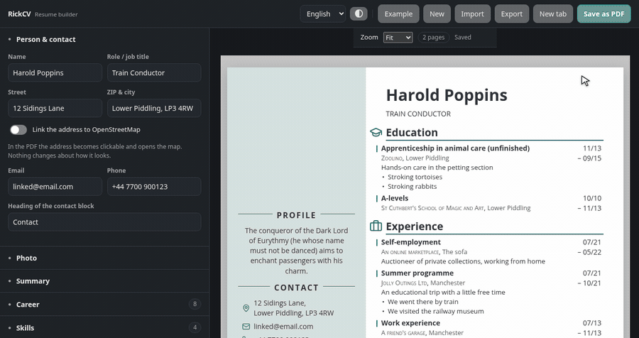
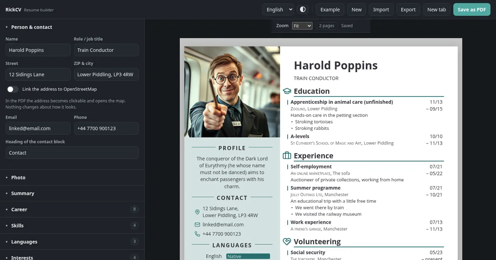
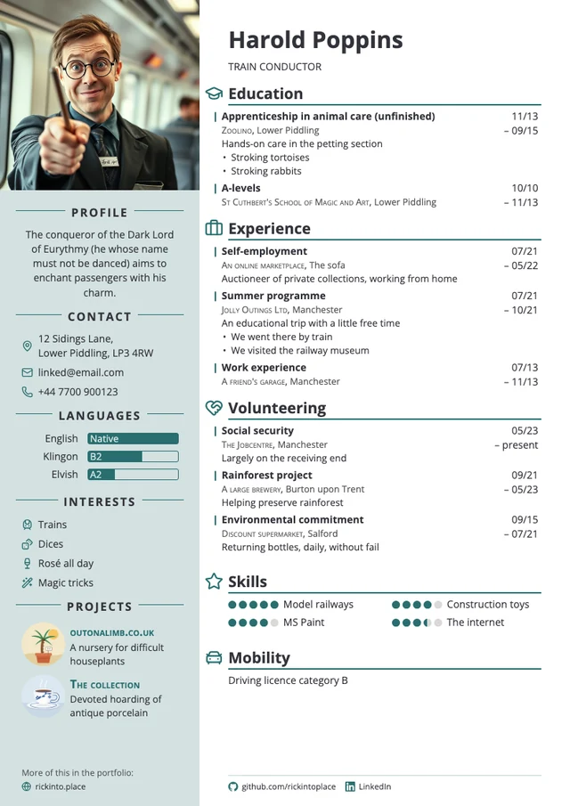
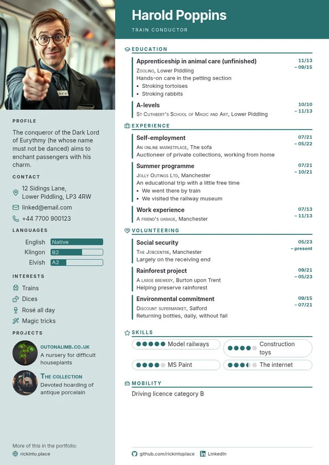
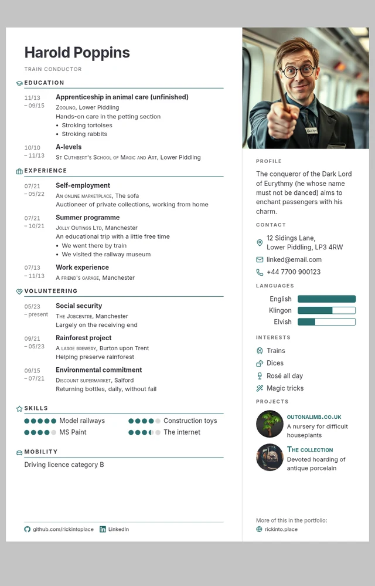

# RickCV
     _____  _      _     _______      __
    |  __ \(_)    | |   / ____\ \    / /
    | |__) |_  ___| | _| |     \ \  / / 
    |  _  /| |/ __| |/ / |      \ \/ /  
    | | \ \| | (__|   <| |____   \  /   
    |_|  \_\_|\___|_|\_\\_____|   \/  [rɪk-si-vi]
    A dynamic template for your resume and cover letter

**Resume and cover letter builder that runs entirely in your browser.** No account, no
upload, no server. Your data stays on your device.

**Use it here: <https://cv.rickinto.place/>**



## What it does

- **Live editor.** Form on the left, the finished document on the right, updated as you type.
  Click anything in the preview to jump to its field.
- **Imports your old resume.** PDF, Word (`.docx`), LinkedIn export, JSON Resume, Reactive
  Resume, a RickCV backup or plain text. Read locally without an AI model, and shown to you
  before anything changes.
- **Cover letter included**, laid out to DIN 5008 for German applications.
- **Nine themes**, or your own: a theme is one CSS file, and you can write it inside the builder.
- **Detailed styling.** Colours, typefaces, font size, sidebar width, margins, heading sizes,
  spacing. Your choices override the theme, and one button hands the palette back to it.
- **Real pages.** A4 or US Letter, as many sheets as the content needs, blocks never cut in
  half. The preview shows exactly what the PDF will contain. You decide what follow-up sheets
  repeat (sidebar, header, contact, photo).
- **Your own sections.** Rename, reorder or add career categories. "My journey" still exports
  as professional experience.
- **Optional blocks** for skills, languages, interests, projects, mobility, references and
  links, plus the place and date line German resumes end with.
- **Honest ATS support.** Tagged PDF, a clean reading order, no hidden text. You can see and
  edit what an applicant tracking system reads.
- **Works with your AI.** No model built in, but RickCV writes a ready brief for a chat or an
  agent, and the answer goes back in through the normal import.
- **German and English** for interface and document. Light and dark mode.
- **Undo and redo** for everything, including replacing the whole document.
- **Fully keyboard operable.**
- **Works offline.** Fonts and around 150 icons ship with it. No request ever reaches a
  third party.
- **Export** as PDF, RickCV backup, `resume.json` (JSON Resume), a shareable link or raw JSON.



## Themes

<p align="center">



</p>

[All nine with pictures](themes/README.md):

| Theme | |
| --- | --- |
| **Clean** | the calm baseline: timeline at the edge, dates on the right |
| **Dynaline** | the timeline as an axis; how long something lasted sets the distance |
| **Icons** | symbols carry the layout, timeline down the middle |
| **Classic** | serifs, small caps and hairlines, hanging dates |
| **Compact** | the date sits on the title's line; two sheets elsewhere fit on one |
| **Terminal** | monospaced, square, dark sidebar |
| **Right Rail** | sidebar on the right without fill, career starts at the left edge |
| **Margin Heads** | section headings sit in the margin beside their section |
| **Banner** | a coloured band carries the name, skills sit in pills |

Any other `.css` file can be dropped onto the builder or picked under **Themes**.

## Importing

Drop a file anywhere on the page or use **Import**:

| What you have | Notes |
| --- | --- |
| RickCV backup (`*.rickcv.json`) | Everything comes back, styling included. |
| [JSON Resume](https://jsonresume.org/schema) | All sections are mapped. |
| [Reactive Resume](https://rxresu.me/) export | Current format and v4, skill levels and hidden items kept. |
| LinkedIn data | *Settings → Data privacy → Get a copy of your data*, then drop the ZIP (or the CSV files). |
| Word (`.docx`) | The best source for an old resume, text boxes and pictures included. Save `.doc` as `.docx` first. |
| PDF | Columns, headings, dates, pictures and a cover letter are recognised. Scanned PDFs contain no text and cannot be read. |
| Anything else | Paste the text. |

The dialog first shows what it found and lets you **replace** the document (your styling
stays) or **add** to it. Nothing changes until you confirm. Structured formats are exact;
text and PDF imports are a draft and say so. Where little is recognised, the dialog shows the
raw text so you can sort it in by hand.

The PDF import handles sidebars, letter-spaced headings, dates in any position, German
two-column lists (`Go   ●●●●○` becomes a skill rated four of five), photo and signature by
their position, icon fonts, bullets missing from the text layer, and a cover letter before or
after the resume.

## Saving as PDF

Click **Save as PDF**. The first time, RickCV tells you what to set in the print dialog:

| Setting | Value |
| --- | --- |
| Destination | Save as PDF |
| Paper size | A4 (or Letter) |
| Margins | None |
| Background graphics | Enabled |

Every modern browser works. Chromium gives the most predictable margins, page breaks and
colours; Firefox produces a usable PDF as well.

Your document is saved in the browser as you type, but only in that browser on that device.
Use **Export** for a backup or to keep several versions.

## ATS and hidden text

RickCV no longer hides a copy of your data behind the layout by default. Detectors treat
invisible text as manipulation, and in a study of 196,682 real resumes about 1 % carried it,
mostly hidden skill lists.

What actually helps: a tagged PDF with a proper reading order, name and contact before the
career, SVG icons that leave no stray words in the extracted text, and the document title as
PDF title and filename. For very graphic layouts, **Machine readability** adds a *visible*
plain-text page you can read and edit. The invisible mode still exists, clearly marked.

Generative Engine Optimization (GEO) has no proven, stable effect according to a 2026 survey
of 45 studies, so RickCV does not do it.

Sources: [Prompt injection in LLM-based resume screening](https://arxiv.org/abs/2605.28999) ·
[Optimizing Visibility in Generative Engines: A Critical Survey](https://arxiv.org/abs/2607.14035) ·
[PhantomLint](https://arxiv.org/abs/2508.17884) ·
[W3C: reading order in PDF](https://www.w3.org/WAI/WCAG22/Techniques/pdf/PDF3)

## For AI agents

An agent can hand a person a finished application as a link:

```
https://cv.rickinto.place/#data=<base64url JSON>&print=1
```

The data travels inside the link (one to three kilobytes without a photo) and goes through the
same confirmation as any import. Format and rules are in [`AGENTS.md`](AGENTS.md), also
available as [`llms.txt`](llms.txt). The PDF itself is always printed in the person's browser.

## Writing a theme

Open **Themes → Workshop**, start from the current theme or an empty skeleton, and see every
change in the document right away. A list of all hooks and variables inserts selectors at the
cursor. **Save as .css** gives you the finished theme. **Contribute** opens a pull request with
your file on GitHub.

The markup is a documented, versioned contract: [`themes/CONTRACT.md`](themes/CONTRACT.md).
Themes live in their own cascade layer and win without `!important`. On load, `@import`,
remote `url()` and rules aimed at the plain-text layer (`.ats-…`) are removed, and the builder
says so.

```bash
python3 tools/build-themes.py          # themes/*.css → js/theme-data.js
python3 tools/make-theme-previews.py   # gallery images for themes/README.md
node tests/theme.test.mjs              # contract + every theme in themes/
```

## Hosting it yourself

RickCV is a static site with nothing to build or configure. Copy the folder to any host, or
just double-click `index.html`.

```bash
git clone https://github.com/rickintoplace/RickCV.git
```

A Content-Security-Policy in a `<meta>` tag allows scripts, fonts and images only from the site
itself, so an imported document or theme can neither load a tracking pixel nor run a script.
For the same reason images from web addresses are not shown; upload them instead. A host that
sends headers may add `frame-ancestors 'self'`.

The link-preview tags in `index.html` (`og:url`, `og:image`) point at cv.rickinto.place; on
your own domain, change those two addresses. `python3 tools/make-social-preview.py` redraws
the preview image from the example document.

## Project structure

| Path | Purpose |
| --- | --- |
| `index.html`, `builder.css` | The builder |
| `cv.html`, `styles.css` | The document, shown in the preview and printed |
| `js/model.js` | Data model, example, migration, checks on foreign documents |
| `js/render.js` | Data to resume and cover letter |
| `js/builder.js` | State, saving, preview, printing |
| `js/sections.js`, `js/fields.js` | Editor sections and form controls |
| `js/history.js` | Undo and redo |
| `js/import.js`, `js/import-dialog.js` | JSON Resume, LinkedIn, CSV, text, and the import dialog |
| `js/pdf-import.js`, `js/docx-import.js`, `js/layout.js` | PDF and Word import |
| `js/ats.js` | Plain-text version |
| `js/ai-help.js` | *Let your AI write it* |
| `js/themes.js`, `js/theme-data.js` | Theme handling and the bundled themes |
| `js/icons.js`, `js/icon-data.js`, `js/icon-picker.js`, `js/ui-icons.js` | Icons |
| `js/i18n.js`, `js/focus.js` | Texts in German and English, dialog focus |
| `themes/` | One CSS file per theme, `CONTRACT.md`, `_starter.css` |
| `fonts/`, `licenses/` | Typefaces and their licences |
| `vendor/pdfjs/` | Mozilla's pdf.js, loaded only for PDF imports |
| `tools/` | Font, icon, example image, link preview and demo generators |

Every file is a plain script, which is why `index.html` works by double-click. The
`js/theme-data.js` and `js/icon-data.js` bundles are committed for the same reason.

Typefaces ship as static 400 and 700 files and ligatures are switched off. Both keep every
letter as real text in PDFs printed from Firefox.

## Contributing

Fork, change, open a pull request. There is nothing to install. The easiest contribution is a
theme, the second most useful is a resume RickCV reads badly, added as a fixture to
`tests/fixtures/`.

```bash
node tests/model.test.mjs       # migration, foreign documents, dates, undo
node tests/import.test.mjs      # import parsers
node tests/theme.test.mjs       # theme contract
node tests/app.test.mjs         # the builder in Chromium: CSP, preview, foreign senders
node tests/roundtrip.test.mjs   # prints every theme and reads the PDF back in
```

The browser tests look for Chromium or Chrome in `CHROME`, then `PATH`, then the default
install locations, and are skipped without one. With `REQUIRE_BROWSER=1` (as in CI) a missing
browser fails the run.

## License

[AGPL-3.0-or-later](LICENSE). Use it, change it, host it, also commercially. Anyone who uses
your version, including over a network, must be able to get its source code.

Third-party components keep their licences: [Lucide](https://lucide.dev) icons (ISC), the
typefaces (SIL OFL) and Material Symbols (Apache-2.0) in [`licenses/`](licenses/), and
[pdf.js](https://mozilla.github.io/pdf.js/) (Apache-2.0) in `vendor/`.
