# Themes

Every theme is a single CSS file. How to write one is in
[CONTRACT.md](CONTRACT.md) — and the easiest way is the **workshop**
inside the builder itself: Themes → Workshop, type, watch, download the file.

These pictures are made by `python3 tools/make-theme-previews.py`.

## Academic

For research and teaching: serifs, a centred header, headings in small capitals and hanging years. Set tightly for long lists of positions, talks and publications.

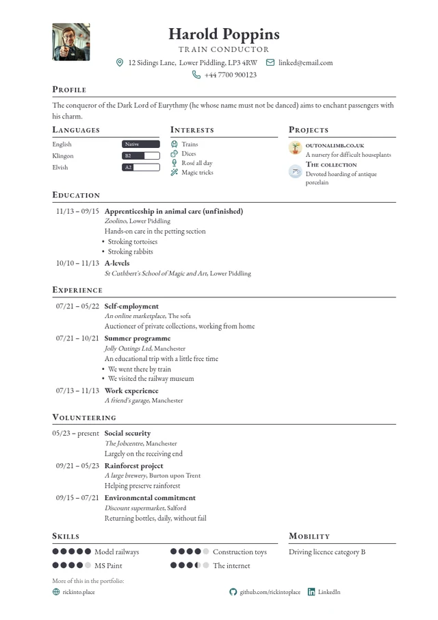

`themes/akademisch.css`

## Banner

A coloured band carries the name across the main column, sections wear small capitals, skills sit in pills. Loud but orderly – for fields where a résumé may stand out.

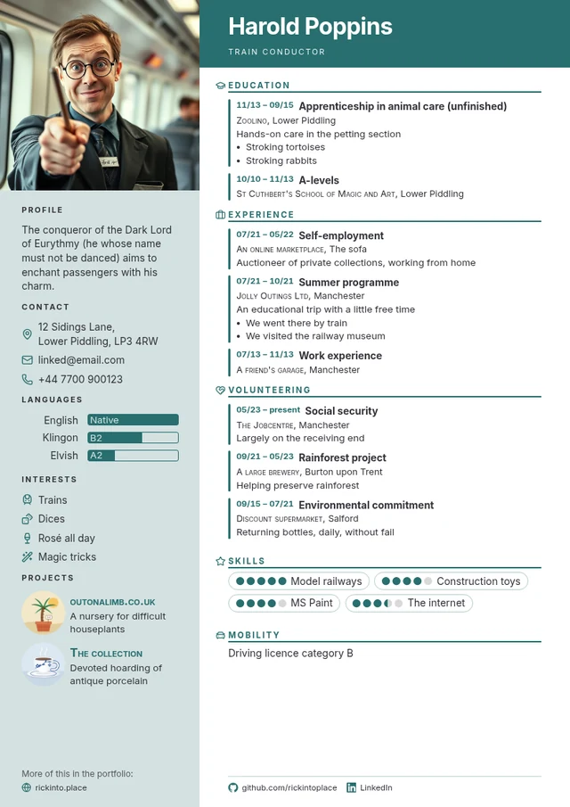

`themes/banner.css`

## Clean

A calm baseline: a fine mark at the edge, dates, title and employer on one line, nothing else. RickCV's original layout.

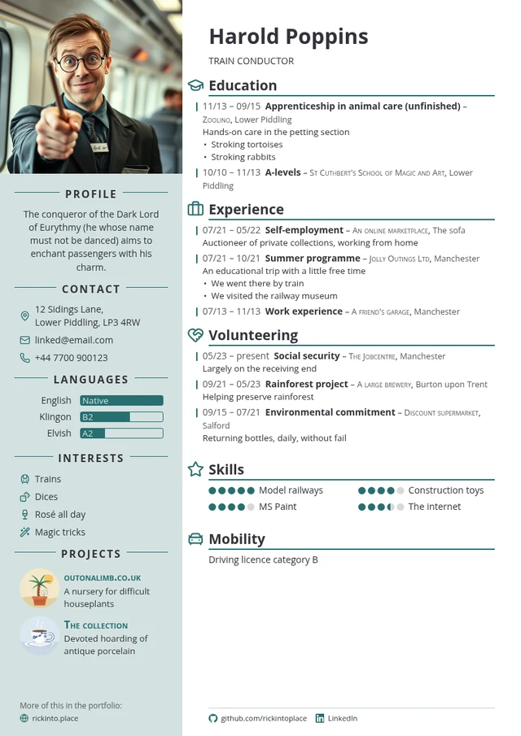

`themes/clean.css`

## Dynaline

The timeline becomes the axis: stations sit on one continuous line, and how long they lasted sets their distance.

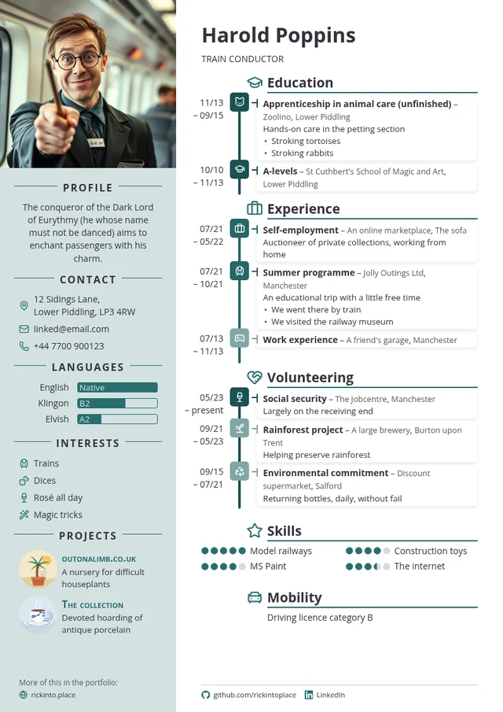

`themes/dynaline.css`

## Single column

One column across the full width: name and contact on top, then the profile, a slim band with languages and interests, then the career as a calm list. The same order for a person and for an applicant tracking system.

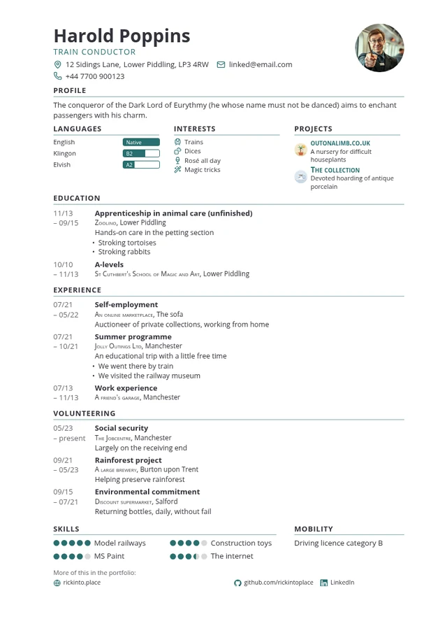

`themes/einspaltig.css`

## First job

For a first résumé: generous spacing, the name in colour, skills as pills, the profile set apart. Little content looks tidy here rather than lost – for school leavers, apprentices and students.

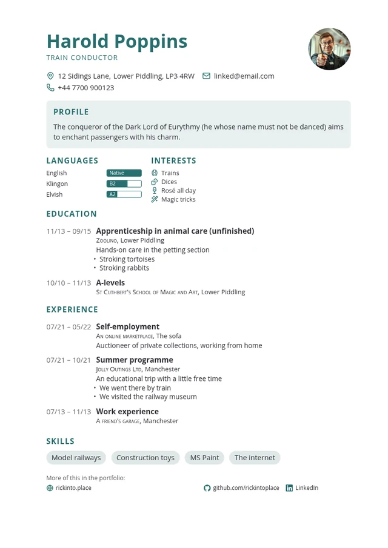

`themes/einsteiger.css`

## Large print

Large type, strong contrast, no light grey, no small capitals. For everyone who would rather read a résumé without glasses – and for copiers, fax machines and black-and-white printing.

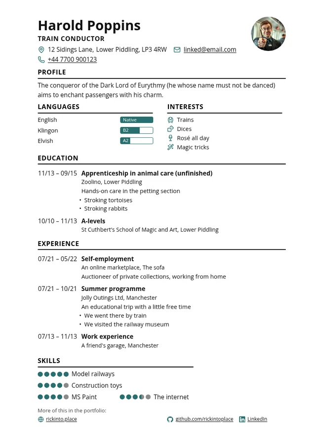

`themes/grossdruck.css`

## Icons

Symbols carry the layout: every station gets its dot, the timeline runs down the middle.

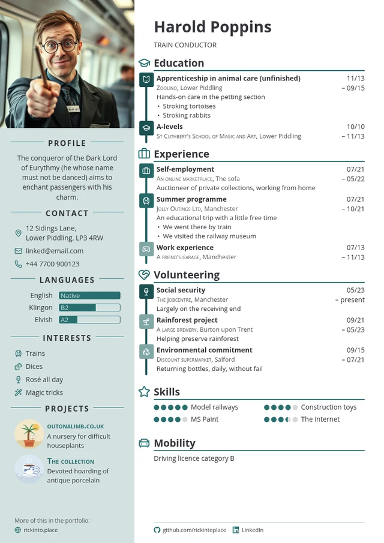

`themes/icons.css`

## Classic

Serifs, small caps, hairlines. No dots, no boxes, no filled areas – stations sit as a list with hanging dates. For applications where restraint is the message.

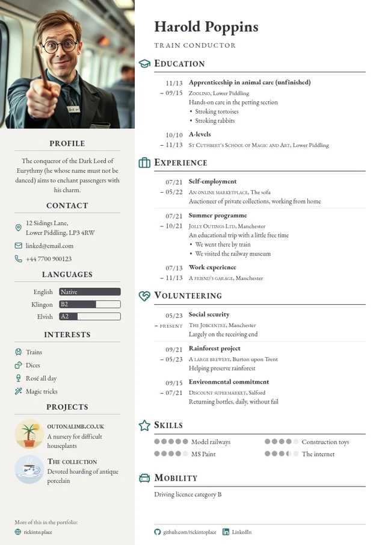

`themes/klassisch.css`

## Compact

For long careers: the date sits on the title's line instead of beside it, bullets move closer, margins shrink. A career that needs two sheets elsewhere fits on one.

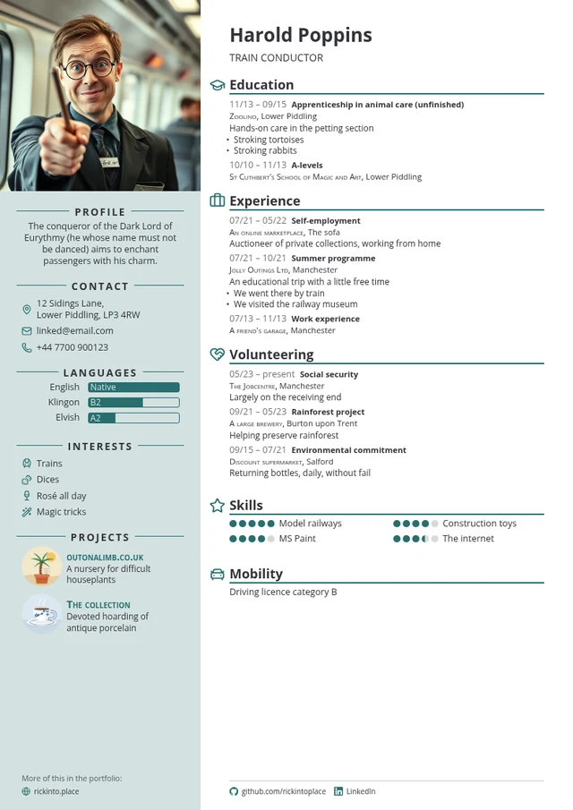

`themes/kompakt.css`

## Margin Heads

Headings sit in the margin beside their section instead of above it. That leaves one calm reading column and saves a line per section – after the résumés of US universities.

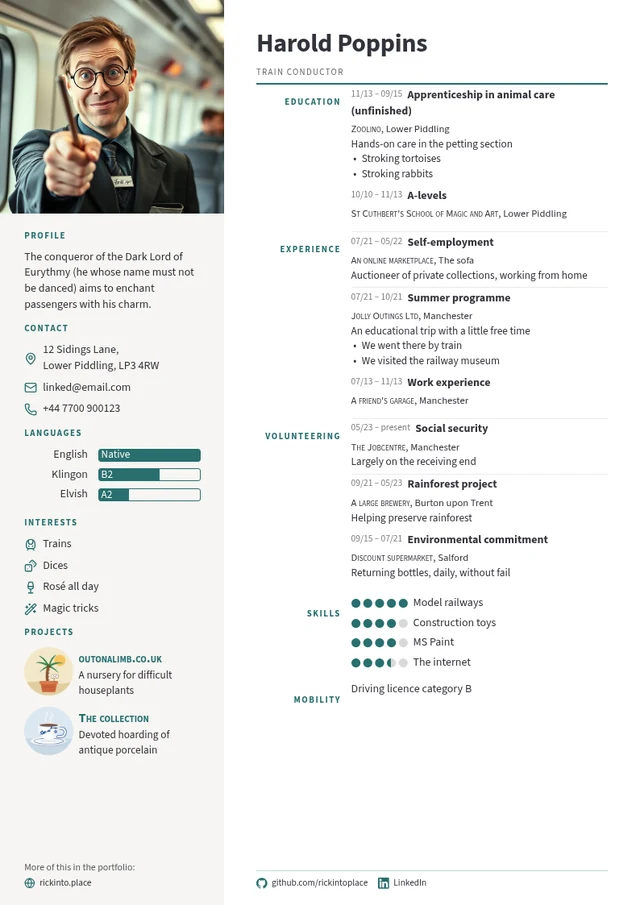

`themes/marginheads.css`

## Right Rail

The sidebar sits on the right, unfilled, set off by a hairline. The career therefore starts at the left edge of the sheet – where the eye starts reading.

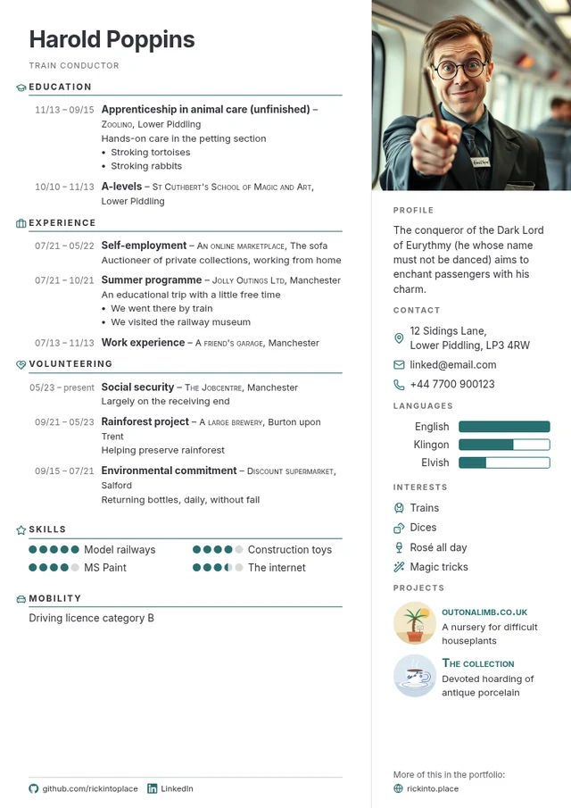

`themes/rightrail.css`

## Terminal

Monospaced, square edges, a dark sidebar. Stations sit against a gutter rule like code in an editor, with a square instead of a dot.

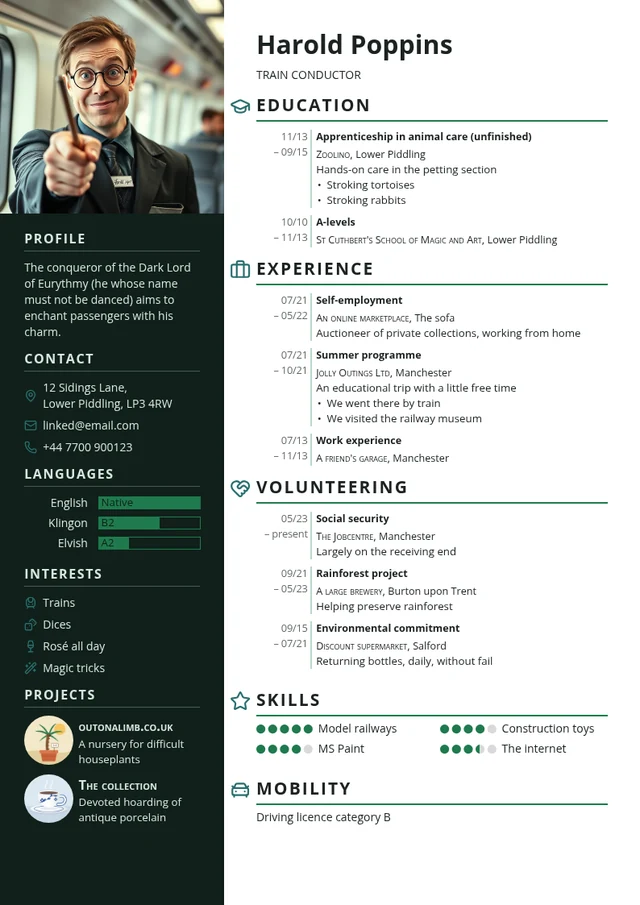

`themes/terminal.css`
